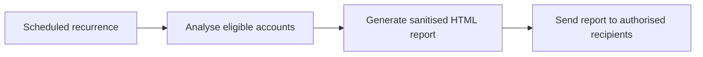

# Automated Customer Churn Risk Review

This repository documents a scheduled workflow that reviews customer account information and recent email communications to identify potential churn risks.

The workflow combines structured customer success data with explicit risk and positive signals found in relevant communications. It then produces an evidence-based HTML report for authorised internal review.

> **Public repository notice:** This repository contains sanitised documentation, configuration examples and synthetic templates only. It must not contain real customer data, email content, internal field names, tenant or environment identifiers, connection references, credentials, production reports or workflow exports.

## Workflow overview


The workflow contains three stages:

1. **Recurrence**  
   Starts the workflow on a configured schedule.

2. **Analyse accounts**  
   Retrieves eligible accounts, reviews customer success information and recent relevant email evidence, and recommends churn forecast actions.

3. **Send an email**  
   Sends the resulting HTML report to authorised internal recipients.



## Purpose

The workflow is designed to:

- Review active customer accounts against controlled churn-risk criteria.
- Use customer success sentiment as the primary assessment signal.
- Supplement the assessment with recent activities, renewal information and commercial data.
- Review recent Outlook communications for explicit risk or positive signals.
- Identify accounts that may need to be added to the churn forecast.
- Recommend whether an existing churn probability should increase, decrease or remain unchanged.
- Highlight accounts where sentiment information is missing or outdated.
- Provide traceable evidence for every recommendation.
- Generate an HTML table that renders correctly in Outlook desktop.

The workflow supports human review. It is not intended to make autonomous commercial, contractual or customer-management decisions.

## Repository structure

```text
customer-churn-risk-review/
├── README.md
├── SECURITY.md
├── .gitignore
├── config/
│   └── settings.example.json
├── docs/
│   └── images/
│       └── workflow-overview.png
└── examples/
    ├── analysis-instructions.template.txt
    ├── report.template.html
    └── synthetic-output.html
```

## High-level architecture

| Component | Purpose | Public-repository guidance |
|---|---|---|
| Scheduler | Runs the review at a defined interval | Document the frequency generically |
| Customer success data source | Supplies account, sentiment, activity, renewal and commercial data | Use placeholders for objects and field names |
| Outlook connector | Retrieves recent customer-related messages | Never commit email content or addresses |
| Analysis step | Evaluates evidence against controlled risk criteria | Store only a sanitised instruction template |
| Report generator | Produces an Outlook-compatible HTML table | Use synthetic examples only |
| Email action | Delivers the report internally | Do not publish recipients or distribution lists |

## Processing scope

The production workflow should filter accounts using organisation-specific account classifications.

The public template uses placeholders:

```text
Record Type = "<ACCOUNT_RECORD_TYPE>"
Customer Type = "<CUSTOMER_TYPE>"
```

Replace these placeholders only in private deployment configuration. Do not commit real values when those values reveal confidential product segmentation or internal account classifications.

## Required data

| Data category | Public placeholder |
|---|---|
| Customer success sentiment | `<CSM_SENTIMENT_FIELD>` |
| Customer success notes and activities | Last `<ACTIVITY_LOOKBACK_DAYS>` days |
| Renewal date | `<RENEWAL_DATE_FIELD>` |
| Annual recurring revenue | `<ARR_FIELD>` |
| Existing churn probability | `<CHURN_PROBABILITY_FIELD>` |
| Existing forecast membership | `<CHURN_FORECAST_SOURCE>` |
| Email evidence | Relevant Outlook emails from the last `<EMAIL_LOOKBACK_DAYS>` days |

Recommended default operational parameters:

```text
Customer success activities: 90 days
Outlook email evidence: 14 days
Upcoming renewal window: 6 months
```

These periods are configurable rather than hard-coded requirements.

## Outlook evidence analysis

For each eligible account, the workflow may review recent messages with a clear relationship to:

- The account.
- A confirmed customer contact.
- An approved customer email domain.
- A relevant customer conversation or thread.

The review can consider:

- Emails received from confirmed customer contacts.
- Emails sent by authorised internal colleagues when the content contains relevant customer-risk information.

An email must not be associated with an account solely because a company name or common word appears in the message. Matching should use verified account identifiers, contact records or approved domain mappings wherever possible.

### Potential churn-risk signals

The analysis may consider explicit evidence of:

- Customer dissatisfaction, complaints or negative feedback.
- Escalations or unresolved support or service issues.
- Implementation, integration, data or product problems.
- Statements that expected value is not being achieved.
- Low adoption or sustained disengagement.
- Pricing, budget or wider commercial concerns.
- Contract or renewal concerns.
- Requests to cancel or terminate.
- Requests to reduce licences, users, sites or spend.
- Downgrade discussions.
- Competitor evaluations or references to alternative solutions.
- Loss or role change of a key stakeholder, sponsor or champion.
- Organisational change, acquisition, restructuring or financial pressure.
- Repeated unanswered follow-ups combined with other evidence of disengagement.
- Explicit statements that renewal is at risk.
- Other direct evidence that can reasonably increase churn risk.

### Positive signals

The analysis should also recognise evidence that may reduce churn risk, including:

- Explicit confirmation of an intention to renew.
- Positive customer feedback.
- Successful resolution of a significant issue.
- Increased engagement or adoption.
- Expansion discussions.
- Strong stakeholder participation.

### Outlook evidence guardrails

The workflow must not:

- Infer sentiment from tone alone.
- Treat neutral language as negative.
- Treat a normal operational question as churn evidence.
- Treat an isolated support issue as churn evidence without material customer impact.
- Assume a delayed reply indicates disengagement.
- Present internal speculation as the customer's confirmed position.
- Change risk merely because an email exists.
- Treat email-domain matching alone as sufficient evidence of account ownership.
- Reproduce unnecessary email content in the output.
- Include unnecessary personal or sensitive information in the report.

Direct customer statements should receive greater weight than internal assumptions. If customer success data and email evidence conflict, the report should state the conflict rather than selecting one interpretation without evidence.

## Assessment logic

Customer success sentiment should be the primary signal. Account activity, renewal timing, commercial data and relevant Outlook evidence provide supporting context.

An account may require review when one or more of the following conditions applies:

- Sentiment is red.
- Amber sentiment shows a negative trend.
- Renewal is within six months and meaningful risk indicators are present.
- An escalation remains unresolved.
- A key customer contact or champion has left.
- The customer has supplied explicit negative feedback.
- Cancellation, downgrade or competitor evaluation has been discussed.
- A significant customer-impacting issue remains unresolved.
- Recent communication contains other direct evidence of renewal risk.

The presence of one condition does not automatically confirm churn. Recommendations must remain proportionate to the combined evidence.

## Churn probability bands

| Band | Probability |
|---|---:|
| Low | 10–25% |
| Medium | 26–50% |
| High | 51–75% |
| Critical | 76–100% |

For an account already included in the forecast, the workflow should recommend one of:

- **Increase %**
- **Decrease %**
- **No change**

For an account not currently included but supported by sufficient evidence of material risk, the workflow should recommend:

- **Add**

Accounts with missing or outdated customer success sentiment should be reported separately and should not receive a guessed assessment.

## Evidence requirements

Every recommendation must include concise and traceable evidence.

### Customer success evidence

Include:

- The relevant field value.
- The note or activity date.
- A concise summary of the material signal.

Synthetic example:

```text
Customer success platform: Sentiment Red, updated 02 Jan.
Activity dated 05 Jan records an unresolved implementation dependency.
```

### Outlook evidence

Include:

- The email date.
- The sender classification or role where appropriate.
- A concise summary of the relevant risk or positive signal.

Synthetic example:

```text
Outlook: 08 Jan, customer contact stated that unresolved implementation
delays are affecting the renewal decision.
```

Do not include full email bodies, signatures, telephone numbers, personal addresses, message identifiers or unnecessary names.

## Analysis instruction template

A complete public-safe instruction template is provided at:

```text
examples/analysis-instructions.template.txt
```

Production field names, account filters, data-source identifiers and recipients should be supplied through private deployment configuration.

## HTML output contract

The generated report should use:

- Inline styles only.
- `border="1"`.
- `cellpadding="6"`.
- `cellspacing="0"`.
- Arial at `10pt`.
- No `<style>` block.
- No CSS classes.
- No flexbox.
- No CSS grid.

The table columns must be:

```text
Account | ARR | Renewal Date | CSM Sentiment | In Forecast? |
Current % | Recommended % | Action | Evidence
```

The report must sort records by:

1. Action, with **Add** first.
2. ARR descending within the action grouping.

After the table, include a two or three-line summary containing:

- Number of accounts recommended to add.
- Number of accounts where the churn probability should change.
- Total ARR at risk.

The reusable HTML template is available at:

```text
examples/report.template.html
```

A fully synthetic rendered example is available at:

```text
examples/synthetic-output.html
```

### Action colours

| Action | `bgcolor` |
|---|---|
| Add | `#F8D7DA` |
| Increase % | `#FFF3CD` |
| Decrease % | `#D4EDDA` |
| No change | `#D4EDDA` |

Colour must not be the only means of communicating an action. The textual action value must always remain present for accessibility.

## Privacy and security controls

### Data minimisation

Only retrieve information required for the churn assessment. Avoid processing:

- Unrelated emails.
- Complete mailbox histories.
- Full message attachments unless specifically required.
- Sensitive personal information.
- Payment or authentication details.
- Personal email addresses unrelated to the account.

Store concise evidence summaries rather than full email content.

### Access control

Use least-privilege connections:

- Customer success access should be restricted to the required account fields and activities.
- Outlook access should be limited to the mailbox and operations required by the workflow.
- Report recipients should be maintained in private environment configuration.
- Production execution should use an approved organisational connection rather than an individual developer's personal connection where possible.
- Connection references should be environment-specific.
- Production access should be reviewed periodically.

### Logging

Do not write the following to public logs:

- Account names.
- Customer domains.
- Contact names.
- Email subjects or bodies.
- ARR values.
- Renewal dates.
- Internal notes.
- Generated reports.
- Connector tokens.
- Tenant or environment identifiers.

Production logging should favour operational metadata such as:

- Execution identifier.
- Start and completion time.
- Number of records processed.
- Success or failure status.
- Sanitised error category.

### Retention

Generated reports should follow the organisation's approved retention policy. Temporary analysis data should be deleted when no longer required.

## Public repository checklist

Before committing a change, confirm that the repository contains none of the following:

- [ ] Real company or product names not intended for public disclosure
- [ ] Customer or prospect names
- [ ] Contact names or email addresses
- [ ] Customer email domains
- [ ] ARR, renewal or churn data
- [ ] Email subjects, bodies or attachments
- [ ] Internal notes or activities
- [ ] Production field API names
- [ ] Report, dashboard or list identifiers
- [ ] Tenant, organisation or environment identifiers
- [ ] Dataverse table or column logical names
- [ ] Connection reference names
- [ ] Workflow run-history screenshots
- [ ] User identifiers or personal connector names
- [ ] Distribution lists or report recipients
- [ ] API keys, secrets, tokens or credentials
- [ ] Production workflow exports
- [ ] `.env` files or local configuration
- [ ] Real generated HTML reports

## Screenshot safety

The overview screenshot should be cropped so it displays only:

- The recurrence trigger.
- The analysis step.
- The email action.
- The connections between those steps.

Before publishing:

1. Export or crop a clean screenshot rather than capturing the full browser window.
2. Remove browser chrome, profile images, environment names and URLs.
3. Check the image at full resolution for tenant or user information.
4. Strip image metadata.
5. Use generic action names.
6. Do not publish screenshots of action configuration, run history, connector settings or outputs.

Use this public filename:

```text
docs/images/workflow-overview.png
```

One option for stripping metadata locally is:

```bash
exiftool -all= docs/images/workflow-overview.png
```

## Example configuration

The file `config/settings.example.json` contains placeholders only. Production values should be stored in an approved deployment environment or secret store and must not be committed.

```json
{
  "accountRecordType": "<ACCOUNT_RECORD_TYPE>",
  "customerType": "<CUSTOMER_TYPE>",
  "activityLookbackDays": 90,
  "emailLookbackDays": 14,
  "renewalWindowMonths": 6,
  "sentimentField": "<CSM_SENTIMENT_FIELD>",
  "renewalDateField": "<RENEWAL_DATE_FIELD>",
  "arrField": "<ARR_FIELD>",
  "churnProbabilityField": "<CHURN_PROBABILITY_FIELD>",
  "forecastSource": "<CHURN_FORECAST_SOURCE>",
  "reportRecipients": ["<INTERNAL_RECIPIENT>"]
}
```

## Testing

Use synthetic accounts and messages for all repository examples.

Test scenarios should cover:

1. A non-forecast account with explicit cancellation evidence.
2. An existing forecast account with stronger risk evidence.
3. An existing forecast account with confirmed renewal evidence.
4. Conflicting customer success and Outlook evidence.
5. Missing or outdated sentiment.
6. An isolated support issue that should not affect churn.
7. A neutral operational email that should not be treated as risk.
8. An unrelated email containing a similar organisation name.
9. An account with no relevant email evidence.
10. Outlook desktop rendering of the final table.

Use clearly synthetic data such as:

```text
Example Account A
customer@example.invalid
£00,000
01 Jan 20XX
```

The reserved `.invalid` domain helps prevent accidental delivery to a real address.

## Human review

Recommendations should be reviewed by an authorised customer success or commercial stakeholder before the official churn forecast is updated.

The reviewer should confirm:

- The evidence belongs to the correct account.
- Direct customer statements have not been taken out of context.
- Internal concerns are clearly labelled as internal.
- The recommended probability is proportionate to the evidence.
- The report does not expose unnecessary personal or confidential information.
- Conflicting evidence is visible.
- Missing data has not been replaced with assumptions.

## Limitations

- Email evidence may be incomplete if conversations occur outside the connected mailbox.
- Account-domain matching can produce false associations.
- Customer success sentiment may be outdated.
- Internal commentary may not represent the customer's position.
- Recent communications may not reflect the account's longer-term history.
- Churn probability remains a business judgement rather than a deterministic calculation.
- The workflow should not update customer records or the official forecast automatically unless a separate approved control process is implemented.

## Responsible use

This workflow is intended to support consistent customer-risk reviews. It should not be used to evaluate individual employee performance or infer personal characteristics, emotions or intentions.

All recommendations must remain explainable, evidence-based and subject to human review.

## Licence

Choose a licence appropriate for the materials being published and obtain the required internal approval. Common options for reusable documentation and templates include the MIT License and Apache License 2.0.
