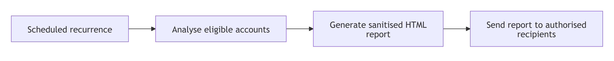

# Customer Churn Risk Review Workflow

Public-safe documentation for a scheduled workflow that combines customer success data and recent email evidence to produce an evidence-based churn risk review.

## Workflow



1. **Recurrence** - starts the workflow on a configured schedule.
2. **Analyse accounts** - reviews eligible accounts using configured customer-success data and recent relevant Outlook evidence.
3. **Send an email** - delivers the generated HTML review to authorised internal recipients.

## Repository structure

```text
customer-churn-risk-review/
├── README.md
├── SECURITY.md
├── .gitignore
├── config/
│   └── settings.example.json
├── docs/
│   ├── architecture.md
│   ├── privacy-and-security.md
│   └── images/
│       └── workflow-overview.png
└── examples/
    ├── analysis-instructions.template.txt
    ├── report.template.html
    └── synthetic-output.html
```

## Safety

This repository intentionally contains no production account data, customer names, email addresses, internal field/API names, tenant IDs, environment IDs, connection references, credentials, real ARR or renewal values, or production workflow exports.

See [SECURITY.md](SECURITY.md) before committing changes.
