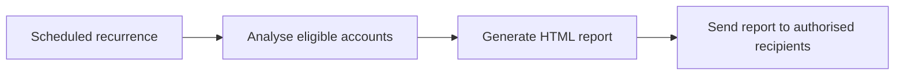

# Architecture

## Flow

## Components

| Component | Purpose |
|---|---|
| Scheduler | Runs the review at a configured interval |
| Customer success data source | Supplies sentiment, activities, renewal and commercial data |
| Outlook connector | Provides recent account-related communication evidence |
| Analysis step | Applies evidence and risk rules |
| HTML output | Creates an Outlook-compatible report |
| Email action | Sends the report to authorised recipients |

## Churn bands

- Low: 10-25%
- Medium: 26-50%
- High: 51-75%
- Critical: 76-100%

## Guardrails

Customer sentiment is the primary signal. Email evidence is supporting evidence only. Do not infer sentiment from tone, treat ordinary operational communication as churn risk, or present internal speculation as the customer's confirmed position. Conflicting evidence must be stated explicitly. Missing or outdated sentiment must not be guessed.
